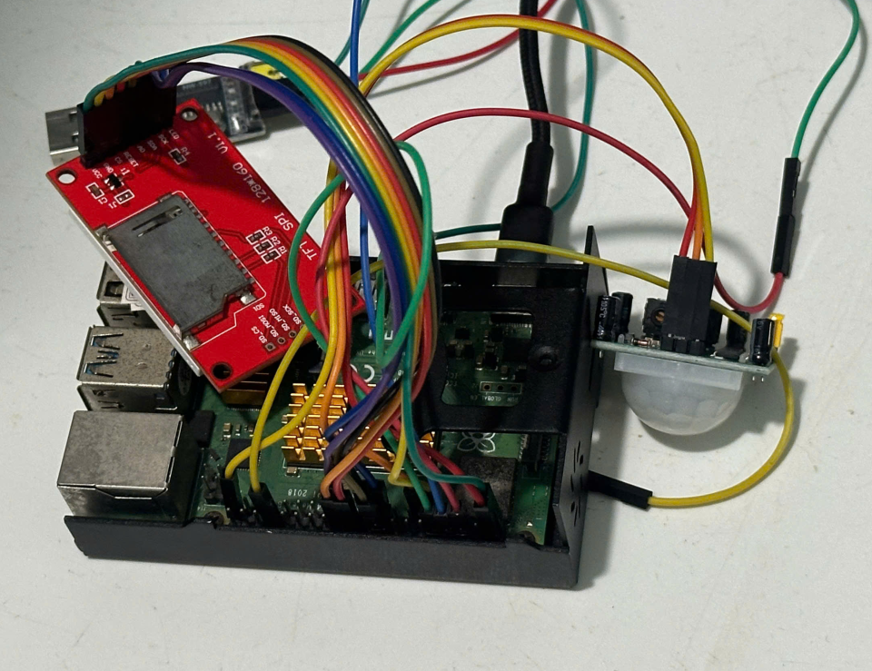

# Face Recognition Attendance on Raspberry Pi

This learning and research project explores how to integrate a sensor, a camera, AI, and a web application on an embedded device running Yocto. The system uses a Raspberry Pi 4 running a 64-bit Yocto image, a Tapo C210 camera, a PIR motion sensor, and an ST7735R TFT display.



## Project Structure

| Directory | Purpose |
| --- | --- |
| `meta-rtsp-camera/` | Sets up Wi-Fi and receives RTSP frames from the camera using GStreamer. |
| `meta-pir/` | Provides the driver and application for reading the PIR motion signal on GPIO17. |
| `meta-tft/` | Provides the driver and application for displaying results on the TFT over SPI0. |
| `meta-attendance/` | Runs YuNet for face detection and SFace for face matching through ONNX Runtime. |
| `meta-attendance-system/` | Coordinates the PIR sensor, camera, AI, and TFT. Stores results in SQLite. |
| `meta-attendance-web/` | Displays process status, recognition results, and daily attendance records. |

When the PIR signal goes HIGH, the controller starts the camera and sends frames to the AI process. Each recognition attempt ends when a match is found or after 8 seconds. The AI process keeps the models loaded for the next attempt and stops after the PIR signal stays LOW for 30 consecutive seconds. The system records the first successful match for each person ID per day, using Vietnam time.


## Hardware Wiring

| Module | Signal | Pi connection | Physical pin |
| --- | --- | --- | --- |
| PIR | OUT | GPIO17 | 11 |
| PIR | VCC | 5 V, if the module is rated for 5 V supply | 2 |
| PIR | GND | Ground | 6 |
| TFT | SDA / DIN | GPIO10 (SPI0 MOSI) | 19 |
| TFT | SCK / SCL | GPIO11 (SPI0 SCLK) | 23 |
| TFT | CS | GPIO8 (SPI0 CE0) | 24 |
| TFT | DC / A0 | GPIO24 | 18 |
| TFT | RST / RES | GPIO25 | 22 |
| TFT | VCC | 3.3 V, if the board supports 3.3 V supply | 1 |
| TFT | GND | Ground | 20 |
| USB-to-UART adapter | RX | GPIO14 (Pi TX) | 8 |
| USB-to-UART adapter | TX | GPIO15 (Pi RX) | 10 |
| USB-to-UART adapter | GND | Ground | 9 |


## Download and Build

Run these commands on Ubuntu. If you already have the Yocto Kirkstone layers, reuse them and clone the project repository alongside them.

```sh
mkdir -p ~/yocto
cd ~/yocto
git clone -b kirkstone https://git.yoctoproject.org/poky
git clone -b kirkstone https://github.com/openembedded/meta-openembedded.git
git clone -b kirkstone https://github.com/agherzan/meta-raspberrypi.git
git clone https://github.com/khiem-07/phase_yocto_base.git

source poky/oe-init-build-env build
bitbake-layers add-layer ../meta-openembedded/meta-oe ../meta-openembedded/meta-python \
  ../meta-openembedded/meta-networking ../meta-raspberrypi \
  ../phase_yocto_base/meta-rtsp-camera \
  ../phase_yocto_base/meta-pir \
  ../phase_yocto_base/meta-tft \
  ../phase_yocto_base/meta-attendance ../phase_yocto_base/meta-attendance-system \
  ../phase_yocto_base/meta-attendance-web
```

Add or update these settings in `build/conf/local.conf`.

```bitbake
MACHINE = "raspberrypi4-64"
ENABLE_UART = "1"
ENABLE_SPI = "1"
DISTRO_FEATURES:append = " systemd"
DISTRO_FEATURES_BACKFILL_CONSIDERED:append = " sysvinit"
VIRTUAL-RUNTIME_init_manager = "systemd"
VIRTUAL-RUNTIME_initscripts = ""
IMAGE_INSTALL:append:pn-core-image-minimal = " camera-wifi iw attendance-system attendance-web"
IMAGE_BOOT_FILES:append = " overlays/pir-overlay.dtbo;overlays/pir-overlay.dtbo"
IMAGE_BOOT_FILES:append = " overlays/st7735r-overlay.dtbo;overlays/st7735r-overlay.dtbo"
RPI_EXTRA_CONFIG:append = "\ndtoverlay=pir-overlay\ndtoverlay=st7735r-overlay\n"
LICENSE_FLAGS_ACCEPTED:append = " commercial_ffmpeg commercial_gstreamer1.0-libav"
SYSTEMD_AUTO_ENABLE:pn-tapo-rtsp = "disable"
```

Run `bitbake core-image-minimal`. The image is in `build/tmp/deploy/images/raspberrypi4-64/`. Decompress `core-image-minimal-raspberrypi4-64.wic.bz2`, write the `.wic` file to an SD card, and connect to the Pi's serial console with Picocom at 115200 baud.

## Setup and Usage

**Wi-Fi.** On the Pi, replace `WIFI_NAME` with your network name and enter the password when prompted.

```sh
nmcli --ask device wifi connect 'WIFI_NAME'
```

**Camera.** Connect the Pi and camera to the same network. In the Tapo app, find the camera's IP address under **Device Info** and create an RTSP account under **Advanced Settings → Camera Account**.

```sh
test -f /etc/tapo-rtsp.conf || cp /etc/tapo-rtsp.conf.example /etc/tapo-rtsp.conf
chmod 600 /etc/tapo-rtsp.conf
vi /etc/tapo-rtsp.conf
```

In the `[camera]` section, replace the example IP in `url=rtsp://192.168.1.50:554/stream2` with your camera's IP address. Enter the `username` and `password` for your **Camera Account** and set `ai-frames=true`.

**Face enrollment.** On Ubuntu, install ImageMagick with `sudo apt install imagemagick` if needed. Convert a photo containing one face to a color PPM file, then copy `SV001.ppm` into the `face` directory in root's home on the Pi.

```sh
convert SV001.jpg -auto-orient -depth 8 ppm:SV001.ppm
```

On the Pi, replace `SV001` with the ID of the person you want to enroll.

```sh
attendance-ai --enroll SV001 --image "$HOME/face/SV001.ppm"
systemctl enable --now attendance-system attendance-web
ip -4 addr show wlan0
```

The message `enrolled id=SV001` confirms that the face template was saved to `/var/lib/attendance-ai/`. To test recognition, walk past the PIR sensor and look at the camera. View logs with `journalctl -u attendance-system -b -f`, or open `http://PI_IP:8080` from a device on the same network, replacing `PI_IP` with the Pi's IP address. The database is stored at `/var/lib/attendance-system/attendance.db`.

## Results and Performance

| Metric | Result |
| --- | --- |
| Camera RTSP `stream2` | About 15 FPS. |
| Recognition time | About 2 seconds per person. |
| Total system RAM usage | About 92 MiB when idle and 200 MiB during recognition, measured on an earlier test build. |
| CPU usage | About 0.2% when idle and 56% during recognition. |
| SD card image size | About 190.2 MiB. |
